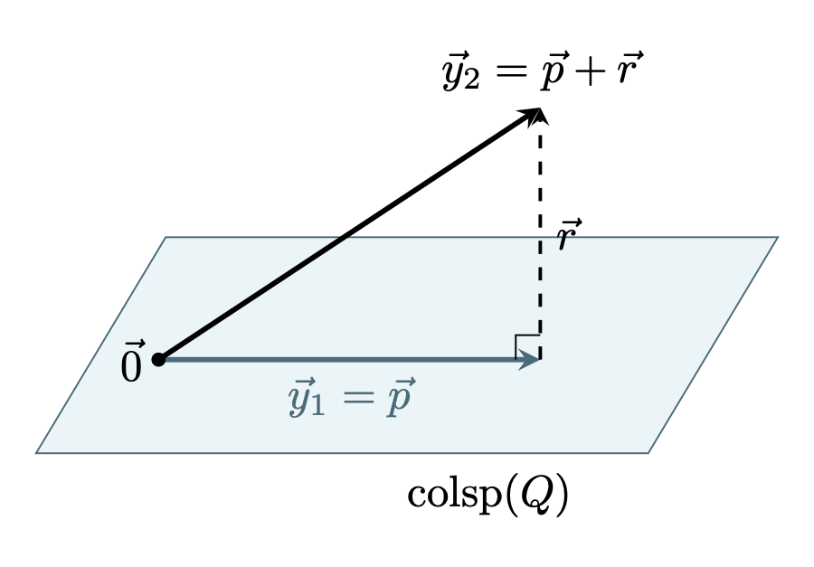

Let

$$
X=\begin{bmatrix}1&4\\\\2&3\\\\2&4\\\\0&2\end{bmatrix},\qquad
\vec q_1=\frac13\begin{bmatrix}1\\\\2\\\\2\\\\0\end{bmatrix}
$$

 We would like to find **orthogonal** unit vectors \\(\vec q&#95;1,\vec q&#95;2\in\mathbb R^4\\) such that

$$
\text{span}(\{\vec q_1,\vec q_2\})=\text{colsp}(X)
$$

a)

6 pts Find one possible \\(\vec q&#95;2\\).

Solution

Let \\(\vec x&#95;2\\) be the second column of \\(X\\). Remove its component in the direction of \\(\vec q&#95;1\\):

$$
\vec q_1\cdot\vec x_2=\frac{4+6+8}{3}=6
$$

$$
\vec u_2=\vec x_2-6\vec q_1
=\begin{bmatrix}4\\\\3\\\\4\\\\2\end{bmatrix}
-\begin{bmatrix}2\\\\4\\\\4\\\\0\end{bmatrix}
=\begin{bmatrix}2\\\\-1\\\\0\\\\2\end{bmatrix}
$$

 Since \\(\|\vec u&#95;2\|=\sqrt{4+1+4}=3\\), one answer is

$$
\boxed{\vec q_2=\frac13\begin{bmatrix}2\\\\-1\\\\0\\\\2\end{bmatrix}}
$$

 This is a unit vector orthogonal to \\(\vec q&#95;1\\). The first column of \\(X\\) is \\(3\vec q&#95;1\\), and its second column is \\(6\vec q&#95;1+3\vec q&#95;2\\), so the two unit vectors span \\(\text{colsp}(X)\\). The negative of this \\(\vec q&#95;2\\) is also valid.

For the remaining parts, suppose \\(Q\\) has orthonormal columns \\(\vec q&#95;1,\vec q&#95;2\in\mathbb R^4\\). You do not need your answer to part (a). Let

$$
Q=\begin{bmatrix}|&|\\\\\vec q_1&\vec q_2\\\\|&|\end{bmatrix},\qquad
Z=\begin{bmatrix}|&|\\\\\vec q_1+\vec q_2&\vec q_1-\vec q_2\\\\|&|\end{bmatrix}
$$

 and suppose \\(\vec y\in\mathbb R^4\\) satisfies

$$
Q^T\vec y=\begin{bmatrix}3\\\\1\end{bmatrix}
$$

b)

2 pts Is \\(\vec y\in\text{colsp}(Q)\\)?

 Yes No Impossible to tell

Solution

 Yes No Impossible to tell

**Impossible to tell.** Let \\(P\\) be the projection matrix onto \\(\text{colsp}(Q)\\). Since the columns of \\(Q\\) are orthonormal, \\(Q^TQ=I&#95;2\\). The projection of \\(\vec y\\) is

$$
\begin{aligned}
\vec p &= P\vec y \\\\
&= Q(Q^TQ)^{-1}Q^T\vec y \\\\
&= QQ^T\vec y \\\\
&= Q\begin{bmatrix}3\\\\1\end{bmatrix} \\\\
&= 3\vec q_1+\vec q_2.
\end{aligned}
$$

 The entries of \\(Q^T\vec y\\) are the coefficients of the projection onto \\(\text{colsp}(Q)\\) in the orthonormal basis \\(\vec q&#95;1,\vec q&#95;2\\). Whether \\(\vec y\\) equals that projection depends on its component orthogonal to \\(\text{colsp}(Q)\\).

To see both possibilities, choose any nonzero vector \\(\vec r\\) orthogonal to \\(\text{colsp}(Q)\\). Such a vector exists because \\(\text{colsp}(Q)\\) is a two-dimensional subspace of \\(\mathbb R^4\\). Compare

$$
\vec y_1=3\vec q_1+\vec q_2,\qquad
\vec y_2=3\vec q_1+\vec q_2+\vec r.
$$

 The vector \\(\vec y&#95;1\\) is in \\(\text{colsp}(Q)\\), while \\(\vec y&#95;2\\) is outside it because \\(\vec r\\) is nonzero and orthogonal to it. Yet \\(Q^T\vec r=\vec 0\\), so \\(Q^T\vec y&#95;1=Q^T\vec y&#95;2=\begin{bmatrix}3\\\\1\end{bmatrix}\\). Both vectors project to \\(3\vec q&#95;1+\vec q&#95;2\\).

Here is a schematic of the two vectors. The dashed arrow is the orthogonal component \\(\vec r\\).

Recall that \\(Q\\) has orthonormal columns, and

$$
Z=\begin{bmatrix}|&|\\\\\vec q_1+\vec q_2&\vec q_1-\vec q_2\\\\|&|\end{bmatrix},\qquad
Q^T\vec y=\begin{bmatrix}3\\\\1\end{bmatrix}
$$

c)

4 pts Which choice gives both the vector \\(\vec w^\ast\\) that minimizes \\(\|\vec y-Z\vec w\|^2\\) and the resulting projection, \\(\vec p=Z\vec w^\ast\\)?

 A. \\(\vec w^\ast=\begin{bmatrix}3\\\\1\end{bmatrix},\quad \vec p=3\vec q&#95;1+\vec q&#95;2\\)

 B. \\(\vec w^\ast=\begin{bmatrix}2\\\\1\end{bmatrix},\quad \vec p=3\vec q&#95;1+\vec q&#95;2\\)

 C. \\(\vec w^\ast=\begin{bmatrix}3\\\\1\end{bmatrix},\quad \vec p=4\vec q&#95;1+2\vec q&#95;2\\)

 D. \\(\vec w^\ast=\begin{bmatrix}2\\\\1\end{bmatrix},\quad \vec p=2\vec q&#95;1+\vec q&#95;2\\)

 E. \\(\vec w^\ast=\begin{bmatrix}1\\\\2\end{bmatrix},\quad \vec p=3\vec q&#95;1+\vec q&#95;2\\)

Solution

 A. \\(\vec w^\ast=\begin{bmatrix}3\\\\1\end{bmatrix},\quad \vec p=3\vec q&#95;1+\vec q&#95;2\\)

 B. \\(\vec w^\ast=\begin{bmatrix}2\\\\1\end{bmatrix},\quad \vec p=3\vec q&#95;1+\vec q&#95;2\\)

 C. \\(\vec w^\ast=\begin{bmatrix}3\\\\1\end{bmatrix},\quad \vec p=4\vec q&#95;1+2\vec q&#95;2\\)

 D. \\(\vec w^\ast=\begin{bmatrix}2\\\\1\end{bmatrix},\quad \vec p=2\vec q&#95;1+\vec q&#95;2\\)

 E. \\(\vec w^\ast=\begin{bmatrix}1\\\\2\end{bmatrix},\quad \vec p=3\vec q&#95;1+\vec q&#95;2\\)

**B.** Adding and subtracting the columns of \\(Z\\) recovers \\(2\vec q&#95;1\\) and \\(2\vec q&#95;2\\), so \\(Z\\) and \\(Q\\) have the same column space. By part (b), the projection onto this space is \\(\vec p=3\vec q&#95;1+\vec q&#95;2\\).

To express this projection in the columns of \\(Z\\), note that \\(Z\vec w=(w&#95;1+w&#95;2)\vec q&#95;1+(w&#95;1-w&#95;2)\vec q&#95;2\\). Independence of \\(\vec q&#95;1,\vec q&#95;2\\) therefore requires

$$
w_1^\ast+w_2^\ast=3,\qquad w_1^\ast-w_2^\ast=1
\quad\Longrightarrow\quad
\boxed{\vec w^\ast=\begin{bmatrix}2\\\\1\end{bmatrix}}
$$

 \\(Q^T\vec y\\) gives coefficients in \\(Q\\)'s columns, while \\(\vec w^\ast\\) gives coefficients in \\(Z\\)'s columns.

d)

4 pts Identify whether each statement is true or false.

<ol class="roman">
<li markdown="1">
(2 pts) For every \\(\vec x\in\mathbb R^2\\), \\(Q^TQ\vec x=\vec x\\).

 True False

Solution

 True False

**True.** Orthonormal columns give \\(Q^TQ=I&#95;2\\), so \\(Q^TQ\vec x=\vec x\\) for every \\(\vec x\in\mathbb R^2\\).

</li>
<li markdown="1">
(2 pts) \\(QQ^T\\) is invertible.

 True False

Solution

 True False

**False.** \\(QQ^T\\) is \\(4\times4\\), and its columns lie in the two-dimensional space \\(\text{colsp}(Q)\\). Its rank is at most \\(2\\), so it is not invertible.

</li>
</ol>

